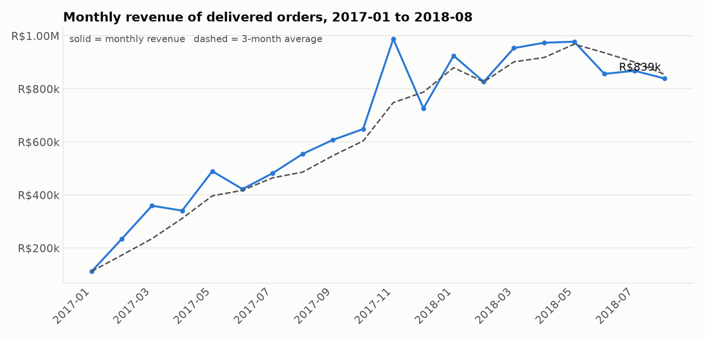
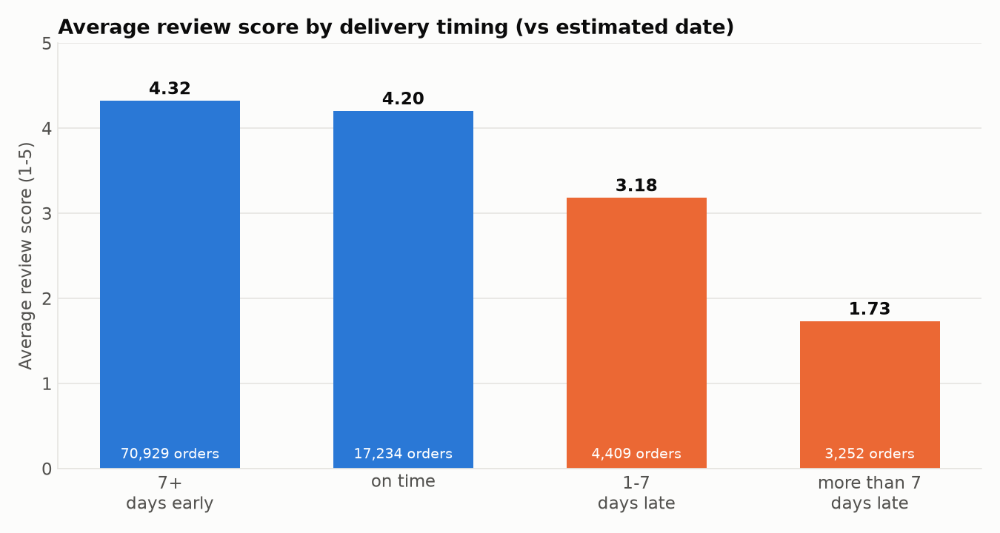

# Olist E-Commerce: Sales Analysis in SQL

Business analysis of a Brazilian online marketplace using **SQL (SQLite)** and Python for charts.
The goal is to answer practical business questions: where revenue comes from, how delivery affects customer satisfaction, and how many customers come back.

## Dataset

[Brazilian E-Commerce Public Dataset by Olist](https://www.kaggle.com/datasets/olistbr/brazilian-ecommerce) (Kaggle): about 100,000 orders from 2016 to 2018, split into 8 related tables
(orders, order items, payments, reviews, customers, products, sellers, category translation).
Revenue in this project means the sum of item prices of **delivered** orders (freight is not included).

## Questions and SQL techniques

| # | Business question | SQL techniques |
|---|---|---|
| 1 | How big is the business? | JOIN of 3 tables, aggregates, COUNT DISTINCT |
| 2 | How does revenue change month by month? | CTE, `strftime`, window functions `LAG`, moving `AVG` |
| 3 | Which categories bring the most revenue? | LEFT JOIN, `COALESCE`, `RANK`, share of total, running total |
| 4 | Best categories in each of the top 5 states? | `ROW_NUMBER` with `PARTITION BY`, multiple CTEs |
| 5 | Where is delivery slow or late? | date arithmetic (`julianday`), conditional aggregation, `HAVING` |
| 6 | Do late deliveries lower review scores? | CTEs, pre-aggregation to avoid duplicates, `CASE` buckets |
| 7 | How many customers buy again? | aggregation over aggregation, window function over `GROUP BY` |
| 8 | How do customers pay? | JOIN, share of total with a window function |
| 9 | Is revenue concentrated in a few sellers? | Pareto analysis: cumulative `SUM` with a window frame |

All queries are in the [`queries/`](queries) folder, one file per question, with comments.

## Key findings

> Fill in after running `python run_analysis.py` (the script prints ready-made sentences and saves them to `results/findings.txt`).

- Revenue grew from [X] in [first month] to [Y] in [last month].
- [Category] is the largest category ([X]% of revenue); the top 3 categories bring [Y]%.
- Orders delivered more than 7 days late get an average review of [X] versus [Y] for on-time orders.
- [X]% of customers bought only once.
- The top 10% of sellers generate [X]% of revenue.




## Business recommendations

- [Example] Delivery delays hurt satisfaction, so prioritize logistics improvements in the slowest states.
- [Example] Most customers buy only once, so test retention campaigns (discounts on the second purchase).
- [Example] Revenue depends on a small group of sellers, so reduce the risk of losing them.

(Replace the examples with conclusions that match your results.)

## How to run

```bash
pip install -r requirements.txt
python get_data.py        # downloads the dataset from Kaggle into data/
python run_analysis.py    # builds olist.db, runs all queries, saves tables and charts
```

To explore the database yourself, open `olist.db` with the VS Code extension "SQLite Viewer" or with DB Browser for SQLite, and run any query from `queries/`.

## Project structure

```
.
├── get_data.py          # downloads the dataset
├── load_data.py         # CSV files -> SQLite database
├── run_analysis.py      # runs queries, saves tables and charts
├── queries/             # 9 SQL files, one per business question
├── results/             # result tables (CSV) and findings
├── images/              # charts
└── requirements.txt
```

## Limitations

- Only delivered orders are analyzed; canceled and unavailable orders are excluded.
- Months at the edges of the data are partial, so monthly trends use 2017-01 to 2018-08.
- The data shows associations (for example, late delivery and low reviews), not proof of cause.

## Author

[ISLAM AIZHAN]| [alizhan1809@gmail.com]
